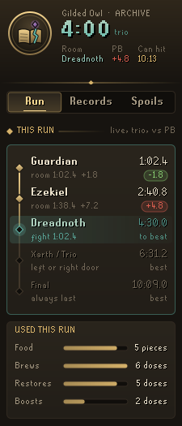
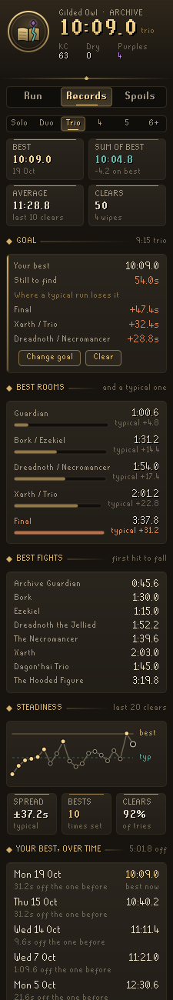
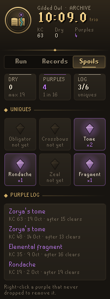
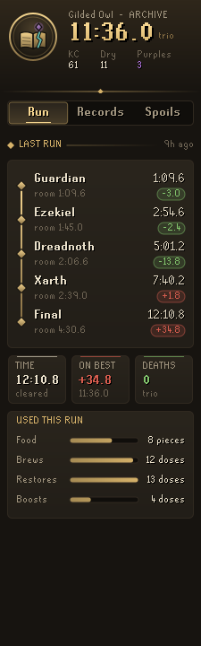
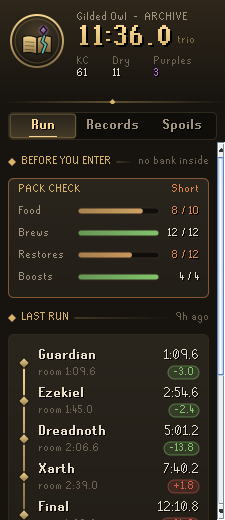
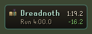
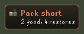
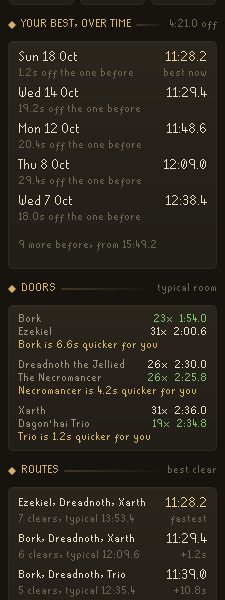
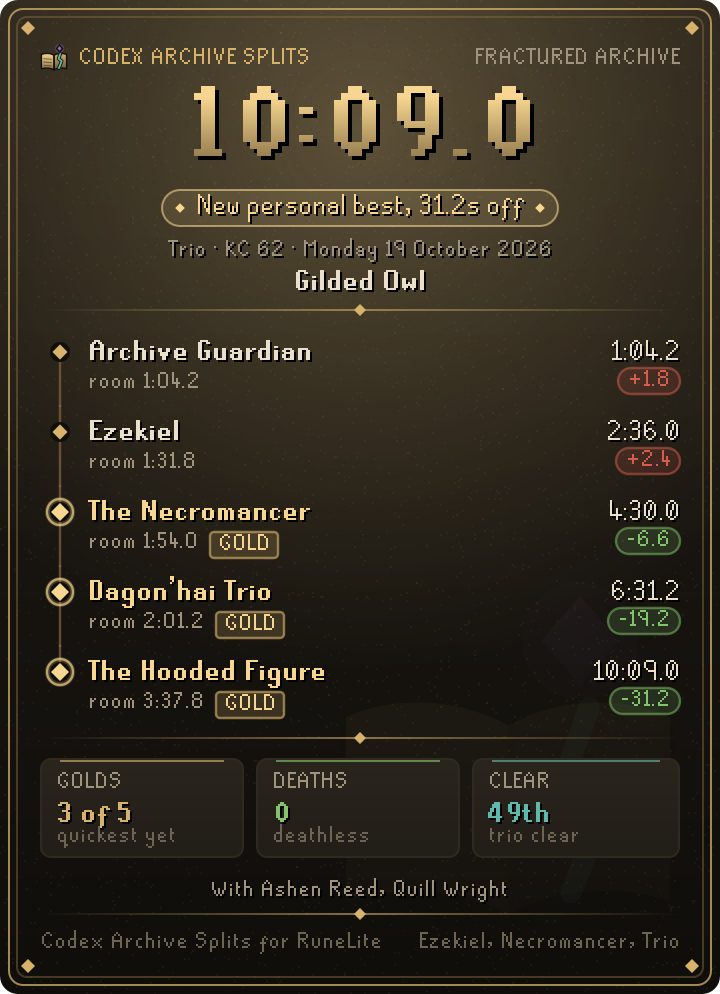
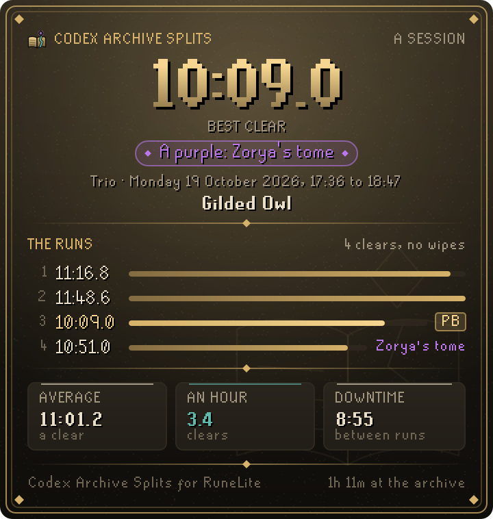

# Codex Archive Splits

**Splits, personal bests and purples for the Fractured Archive.** Codex Archive Splits times every trip into the raid, room by room and fight by fight, and compares each one with your best run for the same party size. It also keeps your purples and dry streak, and checks your pack in the lobby, since nothing can be banked once you're inside.

It is part of the **Codex** suite of RuneLite plugins and shares their look: warm ink, aged gold and the game's own fonts.

<p align="center">
  
  
  
</p>

## What it does

- **Run.** The five encounters of your run, drawn as a thread from the Archive Guardian down to Ocellus. Each boss that falls shows its room time and the run's time when it fell, with a green or red tag for how far ahead or behind your best you are. The boss you're fighting glows, with your best's time at that boss as the mark to beat, and a red tag once you've passed it. Rows you haven't reached show your best's time too. After a run you get its time, how it compares with your previous best, deaths, and how much food and how many potion doses it used.
- **Compare against what matters to you.** Each boss is measured against your choice of your personal best run, your best rooms strung together (golds), your typical run (the median of each room over your last 10 clears), or a goal time you set. Each fallen boss also shows what its room alone gave away against your best room, and the crest and plaque show the best time the run can still hit if every room left goes as well as it ever has.
- **Goal time.** Set a goal for a party size (say 20:00) and the Records page shows how far your best is from it, the date you first beat it, and the three rooms where a typical run loses the most against the goal's pace. The goal is split across the rooms in the shape of your best rooms, so you can pick it as the thing every split is measured against, and the chat line tells you the first time you beat it.
- **Sessions.** Runs less than 45 minutes apart count as one sitting. After a run, the Run page shows this session's clears, clears an hour, average time and the downtime between runs, plus any new best or purple it brought; the Records page lists your last five sessions with their pace and best.
- **Records.** Per party size (solo, duo, trio, 4, 5, 6+): your best time, your sum of best (every row's fastest room added together), the average of your last 10 clears, and clears and wipes. Then the best room for each row with a bar for what a typical run lately gives away there, the worst row lit, and the best fight for each of the eight bosses.
- **Steadiness and doors.** A chart of your last 20 clears with your best and typical times, how much your runs vary, how many times you've set a new best and your clear rate. For each row where you've taken both doors at least three times, which one is quicker for you and by how much.
- **Your best, over time.** Every time you set a new best for a party size, with the date and how much it took off the one before, newest first, and how far your best has come since your first clear.
- **Routes.** Each way through the three rows of doors you have cleared, ranked by its best clear, with how often you took it and your typical time on it. After a clear, the Run page says how it stood on its own route: "Fastest yet through Bork, Dreadnoth, Trio", or how far off that route's best it was, even when a quicker route holds your overall best.
- **Where runs wipe.** The bosses your runs have wiped at, with how many tries there it took and the share that ended there, so you know which fight to practise. A wipe before either door of a row was seen is left out, since there is no telling which door it was.
- **Crew and notes.** The raiders you were with are noted on every run, and the Records page lists who you raid with most and your best clear together. Right-click a run to note your role (tank, melee, ranged, magic, support, learner) or write a note on it, which shows on the run and in the export.
- **Run card.** After a run, press *Save run card* or *Copy run card* on the Run page (or right-click any run on the Records page) for the run on a gilt page made to share: the time large, a ribbon for what it was ("New personal best, 31.2s off", "First trio clear", "Wiped at Xarth"), and the five bosses down a thread with each room's time, the run's time at the fall and the gap to your best there. Every room that was your quickest yet carries a gold mark. Under it: how many golds, deaths, which clear of that party size it was, the crew and the route. A run is always measured against the runs before it, so an old personal best's card still says so. Turn off *Name on cards* to share one without your name or your party's.
- **Session card.** Under *This session* on the Run page, *Save session card* or *Copy* gives the whole sitting on the same gilt page: the sitting's best clear large, a ribbon for what it brought (a purple, a new best, a first clear, or how close it came to your best), and every run as a bar of its time with its tags, the best lit and each wipe saying where it stopped. A sitting of more than twelve runs shows its latest, always with its best among them. Under it: the average clear, clears an hour and the time between runs; a sitting without a clear says how far it got and how many bosses fell instead. *Name on cards* leaves your name off this one too.
- **Share and export.** Right-click a run to copy its splits as text for a chat, or save your whole history as a spreadsheet (CSV) with every room and fight in seconds, through RuneLite's own save dialog.
- **Spoils.** Your dry streak and the longest you've gone, your purples and how often they come, how much of the log you have, a tablet for each unique that lights up once you've got it, and a log of every purple with the KC it came on and how many clears it took.
- **Pack check.** In the lobby, bars for food, brews, restores and boosts against the amounts you set in the plugin's settings, plus a plaque in the game view naming anything you're short of. Set a supply to 0 to leave it out of the check, or all of them to turn the check off.
- **Live plaque and chat splits.** A small plaque in the game view during a run shows the current room, its clock, the run's clock and how you stand against what you compare with, and stays for a few seconds after a clear. A line in the chat box gives each boss's time and how it stands, and the final time when the run ends. Both can be turned off.
- **Fixing mistakes.** Right-click a run on the Records page and choose delete, or a purple on the Spoils page to remove it, if the plugin ever got one wrong. Your records and dry streak are worked out again without it.
- **Check this run.** When a row went untimed, the Run page says what the plugin saw: the big foes the run fought that no boss matched. A wrong split is easy to spot and delete.

<p align="center">
  
  
  <br>
  
  
  <br>
  
  <br>
  
  
</p>

## Settings that matter

- **Splits plaque** and **Splits in chat** (both on): the live plaque in the game view during a run, and the chat line as each boss falls.
- **Compare against** (personal best): what every split is measured against, your best run, your best rooms, your typical run or your goal time.
- **Name on cards** (on): your name, and your party's on run cards; off, cards can be shared without any names.
- **Pack check**: **Pack warning** (on) and the food, brew, restore and boost amounts you want in your pack; 0 leaves a supply out.

## With other Codex plugins

Archive Splits works on its own and reads nothing from the other Codex plugins.

## How it times

Everything is counted in game ticks (0.6 seconds), so every time is exact to the tenth of a second. A run starts when you enter the archive from the lobby and ends when Ocellus falls. A room's time runs from the previous boss falling to this one falling, walk included. A fight's time runs from the first hit to the fall.

Bosses are recognised by the game's own NPC ids, so minions (Smorks, jellies, undead binders, imps) and scenery never start or stop a split. Several bosses change form during a fight, so a boss only counts as fallen once nothing of its encounter has been standing or hit for a few ticks, and if it comes back after that, its split opens again. Ocellus only counts in its third phase, the Archive Guardian and Xarth as soon as their beaten forms appear, and the Dagon'hai trio when the elder and both monks are down. The game's completion message always ends a run as a clear.

Purples are picked up by item id when a unique arrives in your inventory or equipment during a run, or after a clear until you open a bank. Swapping, dropping or charging one you already have never counts. The completion count comes from the game's own chat message. Everything is saved per account in your RuneLite profile; the newest 500 runs are kept, along with every run that holds one of your records, and clears and wipes are counted for good. If a save is ever damaged (a figure of the wrong kind, a file cut short), every run and purple that still reads is kept rather than the archive starting afresh, and the save as it was is set aside in your profile before anything is written over it.

## Since launch

Bosses, the lobby and the uniques are matched by the ids the game gave them at launch on 20 October 2026. The wording of the completion and wipe messages is still matched loosely. If one of them is off, the plugin degrades rather than breaks: the run ends when you leave the archive, with every split it saw, and anything it gets wrong can be deleted from the panel.

## Rules posture

Codex Archive Splits only times what has already happened and counts what's in your inventory. It gives no help with boss mechanics: no attack cues, no tile or prayer prompts, nothing that reacts to what a boss is about to do. It doesn't click, change menus or send anything over the network.

## Development

```bash
./gradlew build   # compile and run tests
./gradlew run     # launch RuneLite with the plugin loaded
```

The timing, records and naming rules (`core/`) are plain Java with unit tests. The panel and overlays are in `ui/` and `overlay/`.
